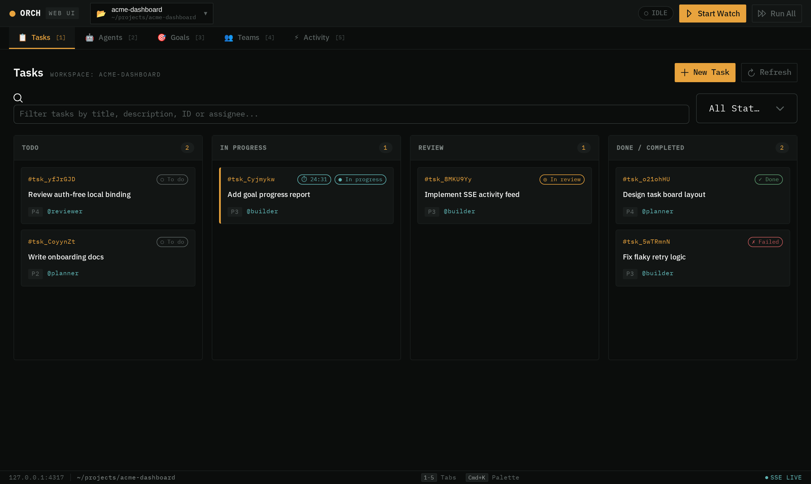
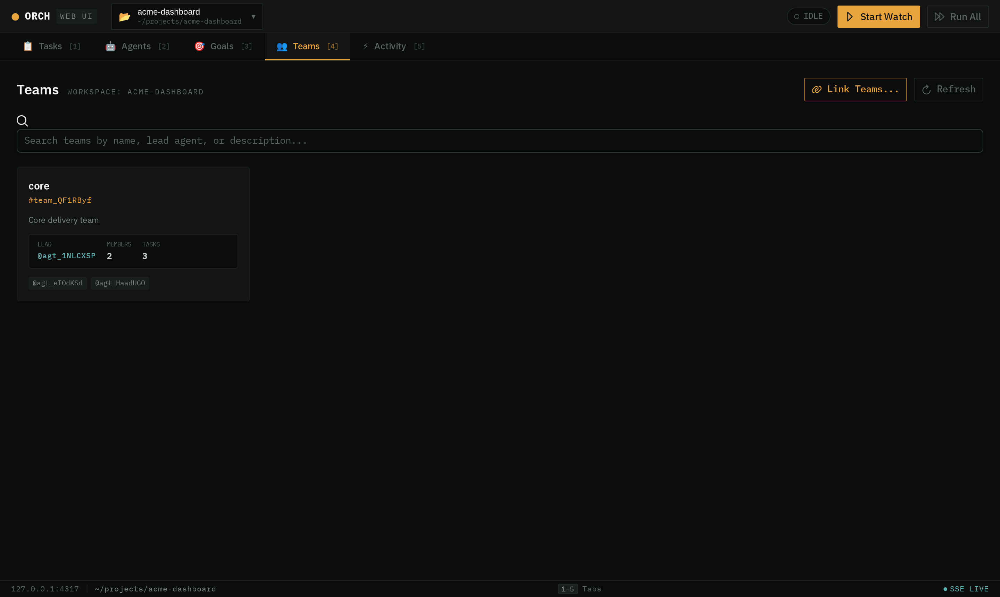
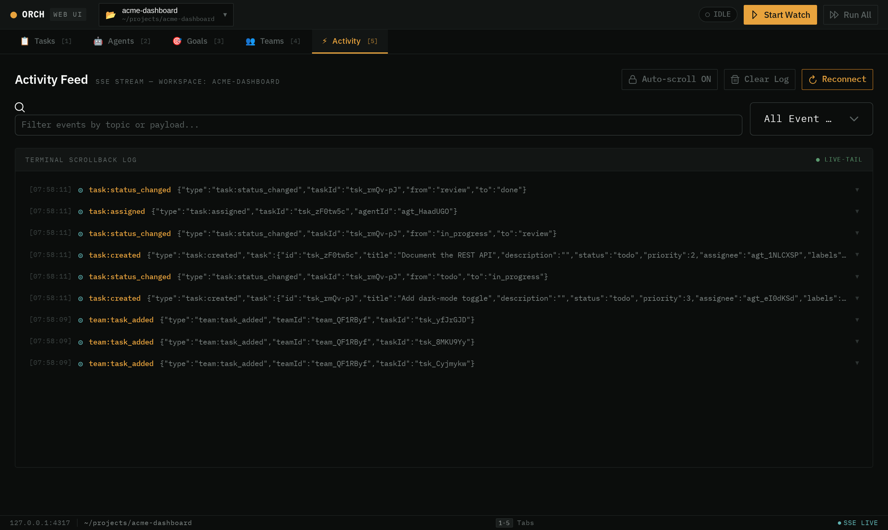

# orch-webui

> **Status: early / alpha.** Unofficial community project, not affiliated with the authors of ORCH. Local-only by design (see [Security](#security)).

Web UI for [`@oxgeneral/orch`](https://www.npmjs.com/package/@oxgeneral/orch) (AI agent orchestrator).
Consumes it as a library (not by scraping CLI output) and mirrors the Ink TUI (`orch tui`) mental
model — Tasks / Agents / Goals / Teams / live activity — in the browser.

## Screenshots

| Tasks | Agents |
| --- | --- |
|  |  |
| **Goals** | **Teams** |
|  |  |



## Features

- **Pick any local folder as a workspace.** A server-side folder browser lets you choose a
  project directory, run `orch init` for it if needed, and switch between several workspaces.
  The list of recent workspaces survives restarts.
- **Tasks, Agents, Goals, Teams** — create, inspect and act on them from the browser, with a
  detail panel for each. Task cards show the assignee's name, not just its ID.
- **Live updates over SSE.** Tasks and Agents refresh in real time from the orchestrator's event
  stream, with a polling fallback when the stream is unavailable. A separate Activity tab shows
  the raw, filterable event feed.
- **Running time, like the TUI.** Running tasks and agents show a live elapsed-time counter,
  using the same compact format as `orch tui`.
- **Token and runtime stats.** Totals for the whole workspace, per agent, and grouped per
  connector (agent adapter such as `claude` or `codex`).
- **Orchestrator control.** Start/stop watch mode and run all from the top bar; the UI reports a
  lock held by another orchestrator process instead of failing silently.
- **Agent and team registry with one-way sync.** Designate a "main" workspace and *link* its
  agents and teams into any other project. Sync is manual (you press Sync); linked items show an
  **outdated** badge when the source changed since the last sync. Name collisions ask for a
  rename, and changes to create-time-only fields offer a guarded "recreate" flow.
- **Local and safe by default.** Binds to `127.0.0.1` only and rejects non-loopback `Host`/`Origin`
  headers (see [Security](#security)).

## Roadmap

Ideas that are not implemented yet:

- Command palette (Cmd+K) for quick actions.
- Toast notifications fed by orchestrator events (task done, agent error, merge conflict).
- **Remaining rate-limit / quota per connector.** Not possible without upstream support: the ORCH
  adapters do not capture provider rate-limit headers or usage, and the CLIs they wrap manage
  their own credentials. Token and runtime stats (above) are the current proxy.

## Stack

- Monorepo, npm workspaces: `apps/server` + `apps/web`.
- `apps/server` — Node 22+, TypeScript, Fastify. Talks to `@oxgeneral/orch` as a library.
- `apps/web` — Vue 3 + Vite + PrimeVue, `@tanstack/vue-query` for REST data, Pinia for
  live-event/session state.
- No database. `@oxgeneral/orch` persists to YAML/JSON under `.orchestry/`; this app's own state
  (recent workspaces, agent/team links) persists to flat JSON under `~/.orch-webui/`.

## Requirements

- Node.js **22.13+** (CI runs 22, 24 and 26; `.nvmrc` pins 24).
  ```bash
  nvm use      # reads .nvmrc (24); any of 22.13+, 24, 26 works
  ```
- A project folder with `.orchestry/` (run `orch init` there first) to point the UI at.

## Install

```bash
npm install
```

Installs both workspaces (`apps/server`, `apps/web`) from the root.

## Run (development)

```bash
npm run dev
```

Runs backend + frontend together (via `concurrently`), each in its own labeled/colored log
stream. Open **http://localhost:4318**.

- Server (`apps/server`) listens on `127.0.0.1:4317` — binds to localhost only, no auth in v1,
  must never be exposed on a network interface.
- Web dev server (Vite, `apps/web`) runs on port `4318` and proxies `/api` to
  `http://127.0.0.1:4317`.
- Ports `4317`/`4318` are deliberately non-default (not `3000`/`5173`/`8080`) so this project
  doesn't collide with other local projects' dev servers running at the same time.

To run them separately instead: `npm run dev:server` / `npm run dev:web`.

### Custom server port

```bash
PORT=5000 npm run dev
```

The Vite proxy reads the same `PORT` variable, so both processes stay in sync.

## Build

```bash
npm run build              # builds both apps/server and apps/web
```

Run the built server:

```bash
npm run start -w apps/server
```

## Typecheck

```bash
npm run typecheck          # both workspaces
npm run typecheck:server
npm run typecheck:web
```

## Lint, typecheck, tests

```bash
npm run lint
npm run typecheck
npm test              # unit tests for both workspaces (Vitest)
```

Manual live scripts that run against a real `.orchestry/` folder (may start real agents):

```bash
npm run test:live:sse -w apps/server
npm run test:live:crud -w apps/server
npm run test:live:registry -w apps/server
```

## Security

This app is a **local-only** tool. The server listens on `127.0.0.1`, has no authentication, and
can browse the filesystem and spawn agent processes. It rejects requests whose `Host` or
`Origin` is not loopback (DNS-rebinding / cross-site protection). Do not expose it on a network
interface or behind a public reverse proxy.

## Notes

- Server routes are thin REST/SSE wrappers over `@oxgeneral/orch` — business logic lives in the
  library, not here.
- `orch init` for a newly-picked folder is the one operation still shelled out to the real `orch`
  CLI binary; everything else goes through the library API.
- See `AGENTS.md` for architecture notes and contributor conventions.

## License

[MIT](LICENSE)
